<div align="center">

# 小奶蛙 · Xiaonaiwa Pets

**一只陪你工作的奶黄色小伙伴，两种喜欢的样子。**

经典 2D · 精修 3D · 9 组动作 · 16 个注视方向

[English](README.en.md) · [下载双版本](https://github.com/JohanZhong/xiaonaiwa-pets/releases/latest) · [安装指南](docs/INSTALL.md) · [反馈问题](https://github.com/JohanZhong/xiaonaiwa-pets/issues/new/choose)


| 经典 2D · 眨眼优化 | 精修 3D · 柔和软胶质感 |
| :---: | :---: |
| 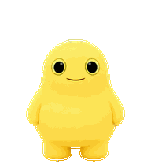 | 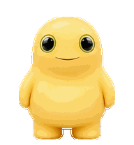 |

</div>

保留原版圆滚滚的造型和动作，在经典版里细化眨眼；3D 版则增加柔和体积、材质层次和眼睛反射。两个版本有独立 ID，可以同时安装、随时切换。

> 非官方同人项目，与 OpenAI 及角色权利人无关联。角色及第三方素材的权利不因本仓库公开而转移；代码与美术的许可范围见 [素材与许可说明](ASSET_NOTICE.md)。

## 选择你的版本

| | 经典 2D | 精修 3D |
| --- | --- | --- |
| 风格 | 原版造型，柔和明暗 | 更鲜明的软胶材质与体积 |
| 动作 | 保留最早版动作，只细化待机眨眼 | 独立制作的完整动作组 |
| 眨眼 | 全睁 → 半闭 → 闭眼 → 微睁 → 大半睁 → 全睁 | 自然眨眼与轻微呼吸 |
| 文件夹 | `pets/xiaonaiwa-2d` | `pets/xiaonaiwa-3d` |

“2D”是本项目经典版的名称，仍保留原画的柔和体积明暗，并非纯平涂矢量画。

## 快速开始

### 让 Codex 帮你安装

复制这段话给 Codex：

> 请检查并安装 https://github.com/JohanZhong/xiaonaiwa-pets 的两个自定义宠物。阅读 README 与安装脚本，校验 manifest.json，把 pets/xiaonaiwa-2d 和 pets/xiaonaiwa-3d 安装到我的 Codex 自定义宠物目录。保留已有宠物，不覆盖同名目录；告诉我如何刷新和选择。

### 手动安装，无需运行脚本

1. 在 [Releases](https://github.com/JohanZhong/xiaonaiwa-pets/releases/latest) 下载 `xiaonaiwa-pets-v1.0.0.zip` 并解压。
2. 在支持自定义宠物的 Codex 桌面版中，打开 **Settings → Pets → Custom pets → Open folder**。
3. 把 `pets` 内的 `xiaonaiwa-2d`、`xiaonaiwa-3d` 文件夹复制进去。
4. 返回设置，点击 **Refresh**，选择其中一版。若界面没有这些入口，请查看 [兼容性与排错](docs/INSTALL.md)。

### 可校验的本地安装

需要 Python 3.9+。下载仓库后在仓库目录执行：

```bash
python scripts/install.py --variant all
```

Windows 可使用 `py -3 scripts/install.py --variant all`。仅安装一版时改为 `--variant 2d` 或 `--variant 3d`。脚本先校验 SHA-256，再复制文件；同名目录默认拒绝覆盖，`--force` 会先创建备份。脚本不联网、不修改应用设置。

## 动起来看看

预览采用 Pets 的固定帧时长，没有视频插帧。GIF 受调色板限制；[2D 全彩 WebP](docs/previews/2d/all-states.webp) / [3D 全彩 WebP](docs/previews/3d/all-states.webp) 更适合查看细节。

| 动作 | 经典 2D | 精修 3D |
| --- | :---: | :---: |
| 挥手打招呼 | 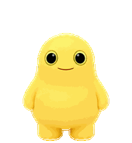 | 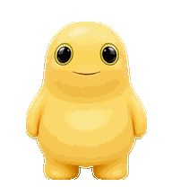 |
| 轻快一跳 | 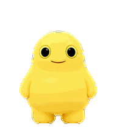 | 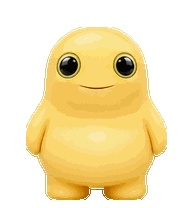 |
| 移动 | 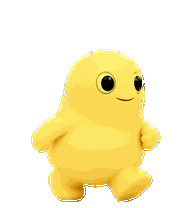 | 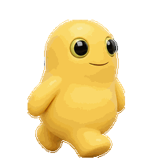 |
| 认真思考 | 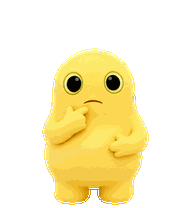 | 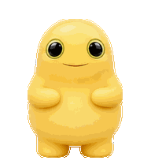 |
| 看向你 | 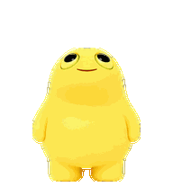 | 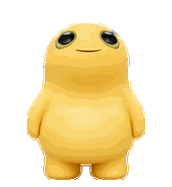 |

[完整动作表与制作约束](docs/ANIMATION.md) · [2D MP4](docs/previews/2d/all-states.mp4) · [3D MP4](docs/previews/3d/all-states.mp4)

## ChatGPT Work Pets

桌面安装与 Work Pets 分开管理。每版的 `work-spritesheet.png` 是 **1536 × 2288 的 v2 PNG**，已通过本项目制作时的 Pets 服务校验。可在支持 Pets 插件的会话中请求：

> 请把这个仓库 pets/xiaonaiwa-2d/work-spritesheet.png 添加为我的 ChatGPT Work 宠物，命名“小奶蛙 · 2D眨眼版”；保留现有宠物。先验证素材，再创建。

3D 版把路径改为 `pets/xiaonaiwa-3d/work-spritesheet.png`。部分旧上传入口只接受九行图集，可用同目录的 `legacy-v1.png`；它没有 16 个注视方向。不要把桌面文件夹复制操作理解为云端同步。

## 质量与维护

- 两版各 73 个有效帧，透明背景，标准 v2 图集；WebP 与 PNG 导出逐像素一致。
- 经典版的其他动作与注视方向保持原版像素，仅修订待机眼皮过渡。
- 安装器覆盖保护、备份行为及损坏文件拒绝均有测试；CI 在 Windows、macOS、Linux 校验。
- 逐帧检查和服务格式校验已经完成；未宣称所有 Codex 版本均经过真实 UI 回归测试。

```bash
python -m pip install -r requirements-dev.txt
python scripts/validate.py
python -m unittest discover -s tests -v
python scripts/build_release.py
```

欢迎通过 [Issue](https://github.com/JohanZhong/xiaonaiwa-pets/issues) 提交具体问题，附版本、操作系统和复现步骤；贡献方式见 [CONTRIBUTING](CONTRIBUTING.md)。觉得有用的话，可以点一个 Star，让更多人发现这只小奶蛙。

